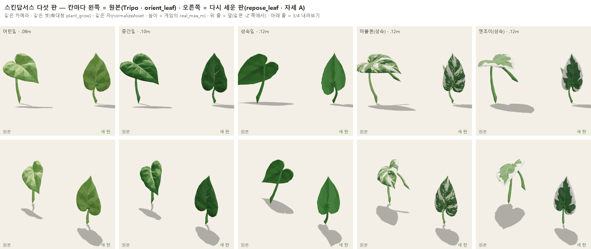

# [leaf → growth] 새 두 종 뼈대 조정표 — 스킨답서스 · 칼라테아 (2026-10-23 · D71 ①② + 스킨답서스 다시 세움)

> 총괄 지시(10-23 · D71) «① 뼈대 조정표 — Tripo 판마다 다른 뼈대를 한 종 안 같은 자로 · 길이 · 자루 위치 보정표 → growth
> · ② manifest real_max_m 를 실측으로». 칼라테아는 본종만 다룹니다(화이트퓨전은 다음 판). 크레딧 0.
> 그 뒤 growth 가 «(가) 스킨답서스 다섯 판을 자세 A 로 다시 세움»을 골랐고, 총괄이 허락했습니다(원래 이름 그대로 덮어씀 · 원본은 `_hf_masters` 에).

- 표(기계용): `assets/plants/skeleton_table.json`
- 그림:
  - `docs/handoff/img/leaf_repose_d71.png` — 원본과 다시 세운 판. 같은 카메라 · 같은 크기.
  - `docs/handoff/img/leaf_skeleton_d71.png` — 뼈대 표의 점 그림.
- 원본 GLB: `C:/Users/pc/Desktop/빛식물/_hf_masters/assets/plants/scindapsus/` (같은 상대 경로 · 433ce1e8 판과 해시가 같음)

## 한 줄 결론

| 종 | 자세 | growth 가 넣을 것 |
|---|---|---|
| **칼라테아 셋** | ✅ 자세 A(겉면 듦 ≤ 7°) | **크기만** — manifest `real_max_m` .12 / .22 / .30 |
| **스킨답서스 다섯** | ✅ **다시 세움** — 다섯 판 모두 자세 A(겉면 −Z 1.0 · 잎몸 축 +Y · 기울기 ≤ 2°) | **크기만** + 무늬판 `skin_scale`(마블퀸 ×1.069 · 엔조이 ×1.101) — 기울기 · 거울 줄은 이제 없습니다 |

## 스킨답서스 다시 세움 (repose_leaf · 10-23)

- **왜 통째 회전으로 안 됐나** — 표면 위 거리(측지)로 다시 재 보니 이 Tripo 판들은 **자루가 잎몸의 하트 홈까지 중맥만큼 길게 올라가고, 잎몸이 거기서 아래로 매달려** 있었습니다(잎끝이 아래·옆).
  자루와 잎몸이 120~150° 꺾여 있어서, 통째로 돌리면 자루나 잎몸 둘 중 하나만 맞습니다.
- **한 일** — `tools/leaf/repose_leaf.py`. 정점 · UV · 텍스처 · 삼각형 수는 그대로입니다.
  - ① 자루 끝에서 메시를 따라 잰 거리로 «관(자루)»과 «판(잎몸)»을 가릅니다. UV 이음매로 갈린 정점은 자리로 붙여 잽니다.
  - ② 자루는 자루 끝 → 자루 윗끝을 +Y 로 통째로 세웁니다.
  - ③ 잎몸은 자루 윗끝 둘레로 통째로 돌립니다. 잎끝은 +Y, 겉면(무늬·잎맥 대비가 큰 쪽)은 −Z 를 봅니다.
  - ④ 자루 맨 윗 토막(표면 거리 0.4%)에서만 두 회전을 섞습니다. 처음에 2% 로 섞었더니 이음에 작은 고리가 생겨서 줄였습니다.
  - ⑤ **자루를 0.6 × 중맥으로 줄였습니다**(Y 로만 줄여서 굵기는 그대로). 칼라테아 본종 셋이 같은 자로 0.44 · 0.69 · 0.68 이라 그 사이 값입니다.
    - 그대로 두면 자루 ≈ 중맥(0.94~1.17배)이라 키가 1.6~1.8배가 됩니다. 그러면 같은 `real_max_m` 에서 잎몸이 30% 넘게 작아지고 «막대사탕» 꼴이 됩니다.
    - 길이를 바꾸려면 `--petiole=` 값을 주고 다시 돌리면 됩니다(원본은 `_hf_masters`).
- **썸네일 다시** — `glb_thumb --view=top` 로 찍었습니다. 곧게 선 잎을 위에서 찍으면 모서리만 보여서, 칼라테아와 같이 겉면이 위를 보게 눕힌 임시 사본(`_out/`)으로 찍었습니다. 색인(`thumbs/index.json`) 크기는 진짜 GLB 의 상자입니다.
- **남은 자국**(QUESTION — 화면에서 거슬리면 말씀해 주십시오)
  - 하트 홈에 자루 끝이 붙는 자리가 작은 매듭으로 보입니다(앞에서 확대하면 보임).
  - 마블퀸 · 엔조이는 **원래 메시에서 잎몸 반쪽이 중맥을 따라 약 45° 접혀** 있습니다(옆에서 보면 날개처럼 벌어짐). 앞에서 보면 왼쪽 가장자리가 조금 삐져나옵니다. 이번에 만든 것이 아니라 Tripo 원본 모양입니다.

## ② manifest — 고친 줄

plan 확정(f2f521f7 · 명세 §D71): SC **어린 .08 · 중간 .10 · 성숙 .12** · CA **.12 / .22 / .30**.
`glb_raw_max` 는 GLB 의 가장 긴 축입니다(열 판 모두 높이). `scale_to_real` = real_max_m / glb_raw_max.

| 판 | real_max_m | glb_raw_max | scale_to_real | 비고 |
|---|---|---|---|---|
| sc_leaf_young | .08 | 1.204 | .0664 | 다시 세움 |
| sc_leaf_mid | .10 (짐작 .12 에서) | 1.21 | .0826 | 다시 세움 |
| sc_leaf_mature | .12 (짐작 .18 에서) | 1.255 | .0956 | 다시 세움 |
| sc_leaf_mature_marblequeen | .12 (.18 에서) | 1.379 | .0870 | 다시 세움 |
| sc_leaf_mature_njoy | .12 (.18 에서) | 1.492 | .0804 | 다시 세움 |
| ca_leaf_young | .12 (.15 에서) | 1.021 | .1175 | |
| ca_leaf_mid | .22 (.30 에서) | 1.038 | .2120 | |
| ca_leaf_mature | .30 (.45 에서) | 1.045 | .2871 | |
| ca_leaf_mid_whitefusion | .22 (.30 에서) | 0.934 | .2356 | 숫자만 본종 단계 값 · 손질 안 함(다음 판) |
| ca_leaf_mature_whitefusion | .30 (.45 에서) | 1.091 | .2749 | 〃 |

- note 의 «⚠ 실측 짐작 · plan 확인 필요»는 «실측 plan 확정(10-23 · D71 · f2f521f7)»으로 바꿨습니다. 스킨답서스 다섯 줄의 source 에는 repose_leaf 줄을 붙였습니다.
- `check_manifest.py` 는 HEAD 와 같은 «8건»입니다(summary 수 둘 + char 초상화 여섯 — 전부터 있던 것 · 총괄 지시로 이 판 뒤에 다시 봄).

## ① 뼈대 조정표 (다시 세운 뒤)

### 자(재는 법)

- **게임과 같은 자**: normalizeAsset(anchorBottom) — 자루 끝(맨 아래 8% 띠의 XZ 무게중심) = 원점 · 높이 1. 실측은 «가장 긴 축 = real_max_m» 입니다.
- **이음 · 잎끝은 표면 위 거리로 잽니다**(`repose_leaf.plan` 과 같은 셈).
  - 자루 윗끝 = 자루 끝에서 잰 거리 띠가 관에서 판으로 넓어지기 바로 앞(띠 폭이 최대의 25%).
  - 잎끝 = 표면 거리가 가장 먼 점.
- 잎몸은 제 평면에서 잽니다.
  - 법선 = 주성분의 가장 얇은 축, 겉면 쪽으로.
  - 축 = 자루 윗끝 → 잎끝(평면 안).
  - 길이×폭 = 그 축과 옆 축으로 잰 폭(귓불 포함).
- 자루 = 자루 끝 → 자루 윗끝 곧은 거리.
- 보정 칸(넣는 순서는 normalizeAsset 뒤, 자루 끝 원점에서):
  1. 기울기 `rotation.x` — 겉면 듦이 10° 넘을 때.
  2. 거울 `scale.x = −1` — 자루 윗끝이 종의 뚜렷한 다수와 반대쪽일 때.
  3. 무늬판 배율 `skin_scale` — 같은 단계 바탕 잎과 잎몸 넓이 √(길이×폭)가 같게.
  - **이번 판은 열 줄 모두 1·2가 없습니다.**

### 스킨답서스 (다시 세운 다섯 판)

| 판 | 단계 | 실측 m | 잎몸 길이×폭(cm) | 자루(cm) | 겉면 듦 · 잎몸 뒤로 · 옆으로(°) | 기울기 보정 rotation.x | X 거울 | 자루 누움(°) | 잎몸 중심(cm) |
|---|---|---|---|---|---|---|---|---|---|
| sc_leaf_young | young | 0.08 | 6.1×4.4 | 2.9 | 0.2 · 0.2 · -2.3 | — | — | 4.9 | [-0.1, 4.4, -0.3] |
| sc_leaf_mid | mid | 0.1 | 7.8×5.0 | 3.6 | 0.1 · 0.1 · 0.3 | — | — | 2.2 | [0.2, 5.4, -0.4] |
| sc_leaf_mature | mature | 0.12 | 10.0×5.8 | 4.3 | -0.0 · -0.0 · 2.2 | — | — | 6.2 | [0.1, 6.7, 0.7] |
| sc_leaf_mature_marblequeen | mature | 0.12 | 9.4×5.4 | 4.7 | -0.1 · -0.1 · 1.1 | — | — | 1.9 | [-0.1, 7.2, -0.2] |
| sc_leaf_mature_njoy | mature | 0.12 | 9.2×5.2 | 4.5 | -0.0 · -0.0 · -1.0 | — | — | 2.0 | [-0.1, 7.4, -0.1] |

| 무늬판 | 바탕 | 판 맞춤 배율(넓이) | (길이로 · 폭으로) | 단계마다 쓸 실측 m(잎몸 넓이 맞춤) |
|---|---|---|---|---|
| sc_leaf_mature_marblequeen | sc_leaf_mature | ×1.069 | ×1.064 · ×1.074 | young 0.087 · mid 0.105 · mature 0.128 |
| sc_leaf_mature_njoy | sc_leaf_mature | ×1.101 | ×1.087 · ×1.115 | young 0.09 · mid 0.108 · mature 0.132 |

- 잎몸(귓불 포함 길이)은 **6.1 → 7.8 → 10.0cm** 로 고르게 큽니다. 자루는 2.9 → 3.6 → 4.3cm 입니다.
- 무늬판은 이제 바탕과 같은 자세 · 같은 자루 비라서, 배율이 길이로 맞추든 폭으로 맞추든 1.06~1.12 안입니다. 넓이 맞춤 값을 권합니다.

### 칼라테아 (본종 셋 · 손대지 않음)

| 판 | 단계 | 실측 m | 잎몸 길이×폭(cm) | 자루(cm) | 겉면 듦 · 잎몸 뒤로 · 옆으로(°) | 기울기 보정 rotation.x | X 거울 | 자루 누움(°) | 잎몸 중심(cm) |
|---|---|---|---|---|---|---|---|---|---|
| ca_leaf_young | young | 0.12 | 9.2×5.8 | 3.8 | 0.5 · 0.5 · 19.7 | — | — | 13.9 | [0.1, 7.8, 0.3] |
| ca_leaf_mid | mid | 0.22 | 14.3×14.8 | 8.9 | 7.2 · 6.9 · -11.7 | — | — | 5.3 | [-0.4, 14.7, 1.0] |
| ca_leaf_mature | mature | 0.3 | 20.4×21.1 | 12.2 | 2.6 · 2.5 · -22.2 | — | — | 6.1 | [-0.7, 19.5, 0.1] |

- 셋 다 자세 A 이고, 잎몸 중심은 자루 끝 바로 위(앞뒤 1cm 안)입니다. **크기만** 넣으면 됩니다.
- «옆으로»(잎몸이 평면 안에서 비스듬함)는 어린잎 +20° · 성숙 −22° 입니다. 로제트에서 잎마다 방향을 돌리니 보정하지 않았습니다.
  - 둥근 오비폴리아 잎은 잎끝이 뚜렷하지 않아, 이 각은 «가장 먼 점» 쪽이라는 정도로만 보십시오.

## 정정 — 433ce1e8 의 첫 표

첫 표(같은 날 433ce1e8)의 **스킨답서스 줄은 이 판으로 갈음합니다.** 칼라테아 줄은 숫자만 조금 바뀌었습니다.

- 첫 표는 높이를 1% 띠로 잘라 «폭이 넓어지는 곳»을 이음으로 잡았습니다. 스킨답서스는 잎몸이 아래로 매달려 있어서 **매달린 잎끝을 이음으로, 위쪽 귓불을 잎끝으로** 잡았습니다.
- 그래서 다음 값들이 틀렸습니다:
  - 잎몸 4.9 → 6.1 → 8.0cm
  - 어린·중간 `rotation.x` −34.5° / −36.9°
  - 성숙 X 거울
  - 무늬판 «잎몸이 누움 58° · 77°»의 해석 (각도 자체는 법선이라 맞았음)
  - 무늬판 배율 ×0.942 / ×0.918
- 지금 자(표면 거리)는 그림(`leaf_skeleton_d71.png` · 잎끝 = 파란 점이 다섯 판 모두 맨 위)으로 확인했습니다.
